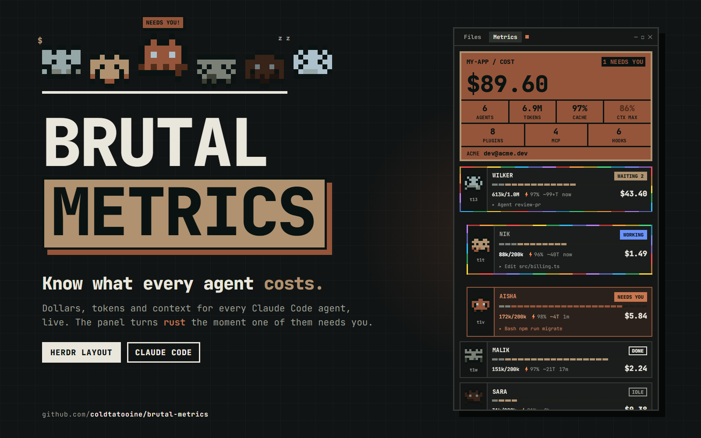

# Brutal Metrics

A [Herdr](https://herdr.dev) layout with a brutalist cost panel. It shows
what each Claude Code agent in a space spends in dollars and tokens, and how
full its context window is.



## Features

- **Cost panel**: the estimated total cost of the space, its agent and token
  counts, and the account each session runs as.
- **One card per agent**, with sub-agents nested under it:
  - a 24-segment context bar split into base (system prompt, tools, MCP),
    conversation and free space;
  - the context size against the window size, the cache hit rate, an
    estimate of turns left, and the time since the last turn;
  - the tool the agent is running;
  - a two-click `/CLEAR` button.
- **Alerts**: when an agent needs you, the panel turns rust and shows a
  blinking `NEEDS YOU`. A parent waiting on its sub-agents shows `WAITING`.
- **Pixel-art avatars**: each agent gets a random sprite, the same in the
  sidebar and in the panel. Active agents' avatars animate, and working agents
  get a moving rainbow border.
- **Files panel**: a lazy file tree of the focused pane's folder, with git
  status marks and a read-only preview.
- **Files** and **Metrics** buttons in the tab bar open the side panel. Each
  space remembers which one was open.

## Install

Paste this into your coding agent:

```
Read ~/.config/herdr-app/AGENTS.md, then add this layout: https://github.com/coldtatooine/brutal-metrics
```

To install it by hand:

1. Copy `layouts/brutal-metrics.json` to `~/.config/herdr-app/layouts/`.
2. Copy the four folders in `mods/` to `~/.config/herdr-app/mods/`.
3. Switch to the layout with `ctrl-shift-l`, or run
   `herdr-app do layout.switch '{"name":"brutal-metrics"}'`.

Your own layout stays as it is. Press `ctrl-shift-l` to switch back.

## Requirements

- **Python 3**: the metrics come from `mods/agent-metrics/collect.py`.
  - On Windows it runs inside WSL. The distro is set by
    `DISTRO = "Ubuntu"` in `mods/agent-metrics/main.js`, so edit that if
    yours has another name.
  - On other systems it runs with `python3`.
- **Claude Code**: other agents appear but show `NO DATA`.

## What it reads and runs

- `collect.py` only reads Claude Code's files:
  - `~/.claude/sessions/*.json` and the session transcripts;
  - `~/.claude.json` or settings `env`, for the account (email, org or
    credential kind, never a token).

  It keeps read offsets in `~/.cache/herdr-metrics.json`. It makes no
  network requests.
- The mods run `hc get` and `hc send` (`/CLEAR` sends `/clear` to the
  agent). They also run `git status` and a folder listing for the Files
  panel.

## Notes

- Costs are **estimates**: token usage times the `PRICES` table in
  `mods/agent-metrics/main.js`. Edit the table to match your models and plan.
- The panel shows each session's login email. Keep that in mind before you
  share a screenshot.

See [RECIPE.md](RECIPE.md) for the full spec, which an agent can use to
rebuild the layout from scratch.
