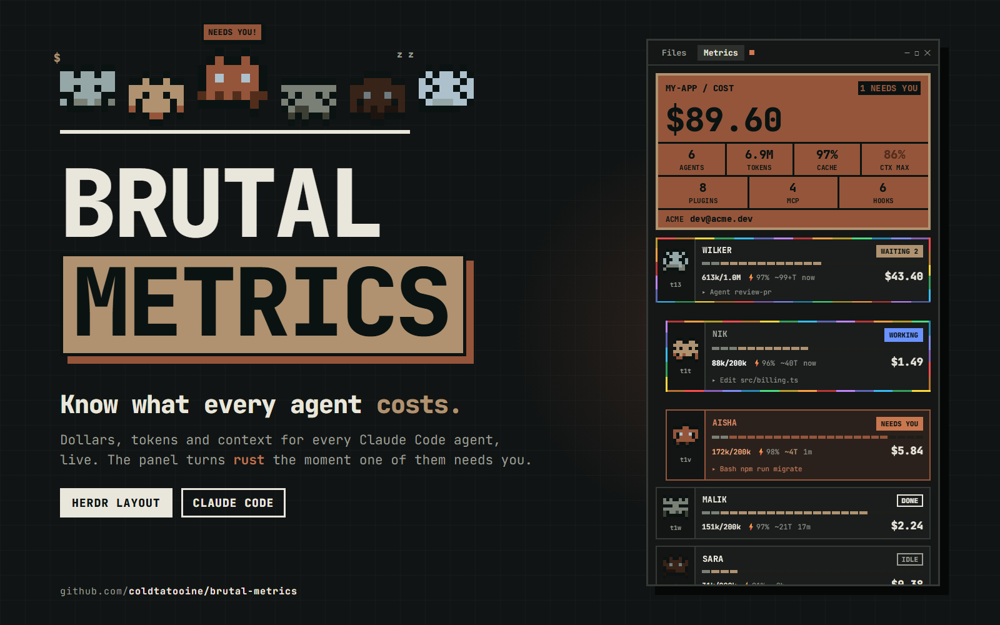

# Herdr + Brutal Metrics

Claude Code's cost and context beside your agents. Herdr's default window gains a **Metrics** button in the tab bar and a brutalist panel on the right. For the selected space it shows what every Claude Code agent (and sub-agent) has spent, in dollars and tokens, and how full its context window is. Each agent has a pixel-art avatar; working agents run a rainbow border, and the panel turns rust and blinks when an agent needs a human. A Files browser shares the same panel.

This is a Herdr layout plus four mods. The [README](README.md) covers installing it; this file is the full spec, which an agent can use to rebuild or update it.

## Installation and updates

This folder is the **complete layout**, not an update payload. Keep the user's original layout intact and install this one separately, under a new name if `brutal-metrics` already exists. If it is already installed, update its mods rather than adding another copy.

For an update requested by an agent, back up and replace only the four folders in `mods/` (`agent-metrics`, `agents-metrics`, `tabs-metrics`, `files-metrics`). Preserve all other layouts, settings, keys, unrelated mods and the selected layout. If a new version needs a layout change, merge only its nodes into the existing tree; a mod update does not replace or switch layouts. `~/.cache/herdr-metrics.json` is the collector's cache: keep it (a cache with an older version is re-read by itself).

Requirements: Python 3 (the collector) and Claude Code (other agents show `NO DATA`). On Windows the collector runs in WSL; the distro is `DISTRO = "Ubuntu"` at the top of `mods/agent-metrics/main.js`, so edit that if yours is named otherwise.

## What you see

Everything is Herdr's `main` layout except four places:

- **Sidebar**, 268px (`chrome` background, not resizable, 44 to 480): the shipped `workspace-chrome` header (46px, window drag area), the shipped `spaces` list and the clone `agents-metrics` split 1:1 (90px minimum each), and the `workspace-chrome` footer (`props.footer: true`, 69px).
  - **Agents list**: each agent's program icon is the pixel-art avatar (2px cells, 16x18) and a working agent's spinner is a small pulsing square; working rows get the rainbow border.
  - One row per agent: a sub-agent is shown only nested under its parent, never also as a top-level row. Inside each group (Pinned, a space, a priority section) agents with sub-agents come first and the loose ones below.
  - A 1px divider in the theme's `input` color (the same as the sub-agent tree lines; `border` is too dark to see), with 8px side margin, separates consecutive groups.
- **Tab bar**, 42px, the clone `tabs-metrics`, a window drag area: the active space's tabs (program icon plus spinner or dot), a `+` menu (the shipped `new-menu` popup), then exactly three panel buttons, **Files**, **Metrics** and **Flow** (no Changes), and min/max/close buttons when the window draws its own. The Metrics button shows a 7px `blocked`-colored dot, blinking, while any agent in the selected space is blocked.
- **Right panel** (`panel`, 368px, 280 to 900, hidden until a button opens it): a stack with three blocks, `files` (clone `files-metrics`), `metrics` (`agent-metrics`) and `flow` (`agent-flow`).
  - **Files tab**: Herdr's file browser, rooted at the agent's project folder (see How it behaves).
  - **Metrics tab**, top to bottom, background `chrome`, JetBrains Mono (shipped with Herdr), bold and black weights, uppercase:
    1. **Summary block**, 8px margin, 3px border `#95a7a7`, fill `#7a8076`, all text `#0a1312`.
       - Row 1 (only when needed): a chip on the right (`N NEEDS YOU`, blinking, or `N WAITING`). There is no title: the selected tab already says what the numbers are.
       - Tabs row: two equal tabs, `LAST TURN` (default) and `TOTAL COST` (10px black, 18px tall, 2px border; the active one is filled with the ink color). Clicking sets the view for the whole panel; it is kept in memory only.
       - Row 2: estimated cost, summed over the space's agents, 42px black (last turn or session total, by tab) (`$40.1`).
       - Rows 3 and 4, each a row of compact cells separated by 2px rules, value over label, both centered (15px black value, 9px label):
         - Row 3: `AGENTS`, `TOKENS` (input + output + cache writes), `CACHE` (the space's cache hit: cache read / (input + cache read + cache write)), `CTX MAX` (the fullest context among the space's agents, in `#522d1b` from 80%).
         - Row 4: `PLUGINS`, `MCP`, `HOOKS`: what the space's folders have configured, the union over its agents (a user-level setting shared by agents counts once). These come from files, so they are configured, not connected: claude.ai connectors, which live in the cloud, are not counted.
       - Last row, 2px rule above: the account strip, organization (10px) and email (11px black), or the credential kind (`API KEY`, `BEDROCK`...). One line per account when the space mixes accounts (`2 CONTAS`, `email xN`).
    2. **Agent cards**, 8px gap, scrolling. Each card: 2px `border`, `surface` fill, indented 12px per sub-agent depth.
       - **Left column**, 60px (46 for sub-agents), 2px rule on its right, with 2px left padding so the avatar sits 4px from the left edge and 2px from the right one. The avatar is centered on `chrome`; pinned to the bottom and centered is the terminal's code (`hc` address, e.g. `t1f`, 10px bold `muted`, 9px for sub-agents, the stamp color when blocked/waiting). Hover: `accent`, underlined; click runs `agent.focus {terminal}` and opens that agent's terminal, sub-agents included (one without a pane gets one).
       - **Right side**: name in caps (12px, 11px for sub-agents, black; `accent` when focused), a status stamp, a 24-segment context bar (5px tall), a data line (11px) and, for active agents, a tool line (10.5px), then a `/COMPACT` and a `/CLEAR` button, side by side, right-aligned (6px gap).
       - **Bar**: first segments `#7a8076` = base (the session's first-turn context: system prompt, tools, rules, skills, MCP), then `#b09270` = conversation, turning `#95553a` at 80% or more, rest `#1d1e19`.
       - **Data line**: `used/window` (bold, `blocked` color from 80%), `⚡cache%`, `~NT` turns until full (sand and bold at 10 or fewer, hidden when the context isn't growing, `99+` cap), time since last activity (`now`, `5m`, `2h`), and right-aligned the card's estimated cost (by tab), 15px black.
       - **Tool line**: `▸ Read main.js`, `▸ Bash npm test`: the last tool the agent called; shown only for working, blocked and waiting agents.
       - **`/COMPACT`**: one click sends `/compact` to the agent with `hc send`. It keeps the conversation as a summary, so there is no confirmation.
       - **`/CLEAR`**: arms on the first click (`CONFIRM?`, 3s); a second click sends `/clear` to the agent with `hc send`.
       - **Account tag**: when the space has more than one account, a card whose account differs from the most common one gets a bordered `@ORG` tag left of the stamp.
  - **Flow tab**: a vertical flowchart of the messages between the space's agents (and their live sub-agent terminals), background `chrome`, JetBrains Mono, sized to the panel (`on_size_change`, divided by Herdr's zoom). Scrolls when it is taller than the panel.
    1. **Orchestrator block** on top, 8px margin, full width, 88px (10px of padding above and below the text): 3px border `#95a7a7`, fill `#7a8076`, text `#0a1312`. Avatar column 56px on `chrome` (5px cells), then `CHIEF OF STAFF` (its role, 11px black; the session title on hover), a `MOCK` chip while the data is simulated, the status stamp; the session title (9px); and `N MSGS` (20px black) with the terminal code. From 520px wide, the latest message it took part in.
    2. **Agent nodes** below, one column: 72px tall with 10px gaps (54px and 8px, avatar 3px cells, when the column would not fit the panel's height); 8px of padding above and below the text (6px compact), so the name, the stamp and the counters never touch the border. The avatar column stays full height with the avatar centered. Heights live in flow.js (COS_H, NODE_H, COMPACT_H, *_PAD_Y); the trunk, stubs, lanes, pulse and rainbow all hang off them. 2px `border`, `surface` fill (`blocked` border and 15% fill when blocked), avatar column 46px (34 compact) on `chrome`; short name in caps (12px black, `accent` when focused; the session title on hover), status stamp (as Metrics, 9.5px); the full session title (9px `dim`, one line, cut by the box; hidden in compact nodes and when it equals the name); a line with the terminal code (click: `agent.focus`), `↑sent ↓received` and, from 520px wide, `▸ →t27 summary` / `▸ ←t24 summary` (`↩` for a reply).
    3. **Lines**, 2px `#3d3f34`, always drawn: a trunk from the orchestrator's bottom (12px from its left edge) down to the last node, and a 16px stub into each node. So the orchestrator is always linked to every agent.
    4. **Peer lanes**: two non-orchestrator agents that messaged each other get a lane on the right (10px from the nodes, 6px apart, the 4 most recent pairs): out of one node's right edge, down or up, into the other's.
    5. **Fired route**: when a send shows up, its whole route (stub, trunk or lane, stub) turns 3px sand `#b09270` with a sand pixel-art arrowhead (2px bars of 10, 6 and 2px) at the receiver's end. It stays sand through the transit and until 8s after firing (`HOT_MS`, or the transit plus 1.5s if longer), then fades back to the idle `#3d3f34` in 1.5s. Colors: idle line `#3d3f34`, fired line and arrow `#b09270`, pulse `#adc1cc`.
    6. **Pulse**: a 6px `#adc1cc` head with a 12px glow (30%) and a trail of 5, 4 and 3px squares (75, 50, 30%) 140ms apart, running the route from sender to receiver at 0.1px/ms, each straight run between 1s and 2.6s (a few seconds in all). It stays on the arrow until the route fades, and fades with it. Several new sends start 1.2s apart.
    7. **Incoming chip**: while a pulse is on its way, the receiver shows `◀ <sender>` on sand (9.5px black `#0a1312`), blinking 0.35 to 1 every 500ms, on its code line.
    8. **Short names**: a top-level agent's tab name (Herdr's default `tb…` ids don't count), else the terminal's hc name, else its `role` label, else the terminal code; caps, cut with `…` past 18 characters. Sub-agents skip the tab (it is their parent's). The orchestrator always shows `CHIEF OF STAFF`.
- Window: `titlebar: "none"`, terminal padding [14, 12], 1px `border` dividers, `canvas` background. Work column: tab bar, body (padding 8, gap 8; panes with the shipped `pane` header, 30px, 1px `border` frame, `accent` when focused, radius 10) and the shipped `workspace-status` bar (28px).
- Palette: the ten swatches of a reference still, `#0a1312 #1d1e19 #3d3f34 #7a8076 #95a7a7 #adc1cc #b09270 #95553a #522d1b #26150d`. The summary block, bar and avatars use only these.

## How it behaves

Status of a card (agent or sub-agent): `blocked` if Herdr reports blocked; `waiting` if it is not blocked but one of its live sub-agent terminals is working or blocked; else Herdr's `working`, `done` or `idle`.

- **blocked** (needs a human): card border `blocked` color with a 15% fill; stamp `NEEDS YOU` solid, blinking opacity 0.2 to 1 every 650ms; summary block turns rust `#95553a` with border `#b09270` and a solid chip `N NEEDS YOU` blinking the same way; avatar steps through its 3 poses every 200ms.
- **waiting** (on other agents): stamp `WAITING N` solid `accent`, opacity 0.45 to 1 every 1500ms; summary chip `N WAITING` (outlined, blinking 1500ms) when nothing is blocked; avatar pose changes every 800ms.
- **working**: stamp `WORKING` solid `working` color; the card (Metrics) and the agent's row (sidebar) get the rainbow border; avatar pose changes every 400ms.
- **idle / done**: outlined stamp, no animation; idle avatar at 0.6 opacity.
- **Rainbow border**: 7 flat colors forming a low-poly ring, facets alternately lit and shaded (72%), stepping one facet per 200ms tick. It is an overlay: it never changes the size or takes clicks.
- **Avatars**: three poses cycled in order: stand, hop (body up one cell, feet left), blink-and-step (eyes shut, feet right). Each agent gets a random body color from the middle six swatches and a random mirrored 8x8 sprite the first time it is seen, kept in shared state `agent.avatars` so both lists agree and it survives restarts. The 200ms redraw timer runs only while some agent is active.
- **Turn**: with the `LAST TURN` tab, cost, `TOKENS`, `CACHE` and the card cost are per turn; `TOTAL COST` uses the session totals. A turn is everything since the person's last prompt (a user line that is not a tool result, meta line, compact summary or `<local-command-` output). `collect.py` keeps a `turn` object per session (input, output, cache read, cache write, and usage by model), zeroes it on each prompt, and adds each model call to it, replacing a message that is streamed twice. Context, `CTX MAX`, `~NT` and the config counts are unchanged.
- **Cost** is an estimate from per-million-token prices by model family (`PRICES` in `agent-metrics/main.js`; opus 15/75/1.5/18.75, haiku 1/5/0.1/1.25, anything else 3/15/0.3/3.75: input, output, cache read, cache write). The window is inferred: over 200k tokens means 1M, else 200k.
- **Accounts**: resolved per session, pinned the first time a session is seen (a later `/login` does not relabel running sessions). Order: a credential in the process env or settings `env` (`ANTHROPIC_API_KEY`, `ANTHROPIC_AUTH_TOKEN`, `CLAUDE_CODE_OAUTH_TOKEN`, `CLAUDE_CODE_USE_BEDROCK` / `_VERTEX` / `_FOUNDRY`) shows `API KEY`, `OAUTH TOKEN`, `BEDROCK`, `VERTEX` or `FOUNDRY` instead of an email; otherwise the `oauthAccount` email and organization from `$CLAUDE_CONFIG_DIR/.claude.json`, else the `.claude.json` beside the session's `.claude` folder; none found shows `?`. Tokens are never read into the output.
- **Agent to session**: first by title (Claude Code sets the terminal title to its session title, so a terminal whose title equals a session's title takes that session; a stale parent title falls through). Two sessions can share a title, so title plus folder (the terminal's cwd equals the session's cwd) pairs first and title alone second; otherwise a terminal elsewhere could take the newer session and the Flow tab would send its messages to another space; otherwise terminals started together launch agents in order, so each agent terminal takes the earliest unused Claude session that started within 60s after the terminal was created (`created_ms` from `hc get <t> --json`); agents without such a match take the newest session with the same folder. Agents without a Claude session show `NO DATA`.
- **Refresh**: the collector runs every 5s; sub-agents (terminals whose `parent` is an agent) are listed under their parent.
- **Flow events**: one per message between agents, oldest first, the last 50, in the collector's shape (`id`, `seq`, `ts`, `from`, `from_name`, `to`, `to_session`, `kind`, `summary` of at most 60 characters). `source.js` picks where they come from: `MODE = "shared"` (now) reads shared state `flow.events` (`{ ok, at, orchestrator, events }`), which `agent-metrics` publishes after each collector run (`publishFlow()`) with `to` resolved by its terminal-to-session match over every agent of every space (the collector only knows `to_session`; unresolved events are dropped). It rewrites the value when the events change and at least every 15s, and writes `ok: false` when the collector fails. While that feed is missing, failed or older than 40s, the tab falls back to the mock (and shows `MOCK`): a simulated send every 2 to 4s between the space's real agents, mostly to or from the orchestrator. `MODE = "mock"` always simulates. Only sends between the selected space's nodes are drawn. Switching between real and simulated takes the current window as already seen, so it fires no burst of pulses. `agent-flow` never runs `collect.py`. `reply` (a send A to B after a B to A) is derived in the mod.
- **Orchestrator**: the published `orchestrator`, else the terminal labelled `role=orchestrator` (`hc label t24 role=orchestrator`), else the first node.
- **Active agent in Flow**: the Metrics rule (working, waiting, or Herdr's `working`) gets the rainbow border. `agent-flow/active.js` holds both options behind `MODE`: `"A"` (now), the facets slide along each edge natively (`.loop("left"/"top")`, 10px facets, one rainbow cycle and back every 2.8s) and the avatar keeps its standing pose. The overlay sits on the node's outer box (not inside its border) and each 3px edge is anchored to its side (`top`/`right`/`bottom`/`left` 0), so all four edges and the corners draw at any width and zoom; `"B"`, the Metrics/Agents border stepping per 200ms tick with the avatar cycling poses (main.js then runs the 200ms tick timer).
- **Flow animation** is native: pulses are `.transition("top"/"left", {duration, delay, easing: "linear"})`; a route is split into chunks of one vertical and one horizontal run, one element per chunk with each property on its own delay, so no dot is left at a corner. Fade-in/out is a delayed `.transition("opacity")`, blinks are `.loop("opacity")`. A pulse is painted at the sender first and gets its targets 150ms later (`MOUNT_MS`): a transition only animates a target that changes after the element was drawn. The mod's timers only poll events (1s) and mount, retarget or remove pulses (`cx.sleep`); none of them steps an animation.
- **Files / Metrics / Flow buttons** show or hide the panel and select its stack child. The choice is remembered per space (localStorage in `tabs-metrics`).
- **Tabs**: drag a tab onto another to reorder it, double-click to rename, right-click for the `menu` popup, scroll wheel to switch tabs.
- **Files**: a lazy tree of the focused pane's folder, with git status marks A/M/D/U and a read-only preview. Limits: 500 entries per folder, 5,000 in total. For an agent started as `wsl.exe -d <distro> ... cd /path && claude`, the tree is rooted at `\\wsl.localhost\<distro>\path` (from the launch command in `hc get` argv), not the terminal's current folder, which may be the launch folder or a subfolder. Other terminals keep Herdr's behavior. The root is looked up in the background; the tree may take about a second to switch the first time a terminal is focused.

## The collector

`mods/agent-metrics/collect.py` is the only source of numbers. It is read-only on Claude Code's files, makes no network requests, and prints one JSON object with a session list.

- **Inputs**: `~/.claude/sessions/*.json` (pid, sessionId, cwd, startedAt) for live sessions; extra roots passed as arguments (for Claude on Windows, `/mnt/c/Users/<you>/.claude`); each session's transcript `projects/<cwd with / \ . : as ->/<sessionId>.jsonl`; `/proc/<pid>/environ`; `settings.json` / `settings.local.json` `env`; and `.claude.json` `oauthAccount` (email and organization only).
- **Incremental reading**: each transcript is read from the last byte offset. Offsets and aggregates live in `~/.cache/herdr-metrics.json`, one entry per session, dropped when the session is gone. The cache carries a version (now 3); an older one is read again from the start. Streamed duplicates of one message id are counted once.
- **Per session it returns**: token totals by model (input, output, cache read, cache write), turns, tool calls, current context size, base (first-turn context), the last 24 context sizes, the last tool, transcript mtime, the account, the session title (`aiTitle`, or the person's `/rename` `customTitle`), and `config`: the names of the MCP servers, the hook handlers and the enabled plugins for the session's folder (see below).
- **Config** (`config_of`, read fresh on every run, not cached): enabled plugins are the `enabledPlugins` entries set true in `settings.json` and `settings.local.json` of the Claude home, then of `<cwd>/.claude/` (later files override). MCP servers are `mcpServers` in `~/.claude.json`, in that file's `projects[<cwd>]`, and in `<cwd>/.mcp.json`, plus each enabled plugin's `.mcp.json` (named `plugin:server`), minus the project's `disabledMcpServers`. Hook handlers are every command under `hooks` in those settings files and in each plugin's `hooks/hooks.json`. Plugin folders come from `plugins/installed_plugins.json` (`installPath`) and are read only for the machine's own Claude home, not for extra roots.
- **How the mod calls it**: on Windows `exec("wsl.exe", ["-d", DISTRO, "python3", <collect.py as /mnt/<drive>/...>, <home>/.claude])`; elsewhere `exec("python3", [<collect.py>, ...])`. Herdr stops an `exec` after 30s; a run takes well under that.

## Built from

- `layouts/brutal-metrics.json`: `layout.clone` of `main` (Herdr 0.1.12, `cloned_from` recorded). Nodes: `sidebar` (`brand`, `sidebar-lists` (`spaces`, `agents`), `sidebar-footer`) and `work` (`tabs`, `work-body` (`main` (tab: active), `panel` → `panel-body` stack (`files`, `metrics`)), `status`). Changes from `main`: the `agents` block uses `agents-metrics`, the `tabs` block uses `tabs-metrics`, `panel-body`'s children are `files` (`files-metrics`), `metrics` (`agent-metrics`) and `flow` (`agent-flow`) instead of `files` and `changes`; `panel` stays `hidden: true`, `active: "files"`.
- `mods/agent-metrics/` (`mod.json` `{ "place": "none" }`):
  - `main.js`: the Metrics tab. Imports `spaces, agents, terminals, panes, exec, hc, appHome, home, window, theme` from `herdr`; `v_flex`, `h_flex` from `gpui-base`; `loop("opacity", ...)` for blinks; `cx.timer.every(5000)` for the collector and `cx.timer.every(200)` for avatar ticks (only while something is active). Also imports `shared, setShared`: `publishFlow()` writes the Flow feed `flow.events` after each collector run.
  - `collect.py`: the collector (see above).
  - `avatar.js`: palette, per-agent random record, 8x8 mirrored sprite, three poses, `avatar(address, px, status, tick)`. Copies of this file are in `agents-metrics/` and `agent-flow/`; keep them identical.
  - `metrics.svg`: the Metrics button icon (axes with three bars).
- `mods/agent-flow/` (`mod.json` `{ "place": "none" }`): the Flow tab.
  - `main.js`: the view. Imports `spaces, agents, terminals, theme, run, settings` from `herdr`; builds the node list as Metrics does, polls events every 1s, fires pulses with `cx.spawn` + `cx.sleep` (mount, target, remove).
  - `flow.js`: `plan({width, height, orchestrator, others, events, now, hotMs})`, the pure geometry: boxes, base lines, peer lanes, hot routes and `route(from, to)` as axis-aligned points.
  - `source.js`: the event source (`MODE` mock or shared, `KEY = "flow.events"`, `ORCHESTRATOR_HINT`), `withKinds`, `orchestratorOf`.
  - `active.js`: the active-agent marker, options A and B (see How it behaves).
  - `avatar.js`: copy of `agent-metrics/avatar.js`.
  - `flow.svg`: the Flow button icon (a box over two boxes on a trunk).
- `mods/agents-metrics/`: `mod.clone` of `agents`; `avatar(...)` replaces the program icon in agent and sub-agent rows, a pulsing square replaces the working spinner, and a 200ms timer redraws only while an agent is active. `render()` drops from the top-level list every agent that `tree()` already nests under a parent (the `nested` set), sorts each of Pinned/rest with agents that have sub-agents first, inserts a `div().h(1)` divider before every group but the first, and still passes `setAgentOrder` the nested agents right after their parent.
- `mods/tabs-metrics/`: `mod.clone` of `tabs`; panel buttons are `files`, `metrics` and `flow` (icon `mods/agent-flow/flow.svg`), with the blinking blocked dot on Metrics; window-button svgs point to `mods/tabs-metrics/`.
- `mods/files-metrics/`: `mod.clone` of `files` (its own svgs); `location()` takes the root from the terminal's launch command via `hc(["get", t, "--json"])`.
- Shipped mods used: `workspace-chrome`, `spaces`, `pane`, `new-menu`, `workspace-status`.
- Herdr functions: `spaces`, `agents`, `terminals`, `panes`, `exec`, `hc`, `appHome`, `home`, `window`, `theme`, `shared` / `setShared`. Commands: `agent.focus`, `layout.select`, `layout.show`, `layout.hide`.
- Programs:
  - `python3` (through `wsl.exe` on Windows) for `collect.py`, which reads only Claude Code's files;
  - `hc get` and `hc send` (`/COMPACT` sends `/compact`, `/CLEAR` sends `/clear`);
  - `git status` and a folder listing for the Files panel.
- Files read: `~/.claude/...` and `.claude.json` as above, and the folder the Files panel shows. Files written: `~/.cache/herdr-metrics.json` only.
- Its look is Herdr's, no theme or fonts of its own, except JetBrains Mono in the Metrics tab.

## Watch out

- The Metrics tab shows each session's login email. Keep that in mind before sharing a screenshot.
- Costs are estimates (token usage times `PRICES`); edit the table to match your models and plan.
- Keep `avatar.js` identical in `agent-metrics/`, `agents-metrics/` and `agent-flow/`, or the lists draw different avatars.
- The Flow tab shows the first 60 characters of agents' messages. Same care with screenshots as for the email.
- Flow pulses follow the collector, not the send: a message shows when the receiver has registered it, plus the refresh interval (about 20s measured when the receiver is busy).
- `on_size_change` reports window px; a mod that positions by px must divide by `settings().zoom`, or it overflows the panel at zoom above 1.
- `scripts/sync-to-herdr.sh` copies `agent-flow` too (it is in `MODS`).
- The Windows collector needs the distro named in `DISTRO`; with the wrong name the cost cell shows `ERR`.
- If a `agent-metrics`, `agents-metrics`, `tabs-metrics`, `files-metrics` or `agent-flow` mod is already installed, rename these and the `mod` names in the layout.
- Herdr does not update layout or mod clones. On a new Herdr version, preserve the user's clone and merge only necessary compatibility changes; rebuilding from the new `main`, `agents`, `tabs` and `files` is an explicit choice, not part of an update.
- QuickJS rejects `??` mixed with `||` or `&&` without parentheses. `herdr-app check` catches it; `node --check` does not.
- `cx.notify()` throws during `render`; start work from a timer or handler, not from `render`.
- Saving a mod's file reloads it and ends the running build's tasks.

## Done when

- `herdr-app check ~/.config/herdr-app/mods/agent-metrics` (and the other four mods, `agent-flow` included) passes.
- `layout.switch {name: "brutal-metrics"}` shows the layout with no `brutal-metrics.error`.
- The tab bar shows Files, Metrics and Flow. Each button shows the panel, a second click hides it, and each space remembers which one was open.
- With a Claude Code agent running, the Metrics tab shows a cost, AGENTS and TOKENS above one card per agent with a context bar, and the cost is not `ERR`.
- A working agent has a moving rainbow border in the panel and in the sidebar; a blocked one blinks `NEEDS YOU` and the summary turns rust.
- Clicking a terminal address focuses that agent; `/CLEAR` asks to confirm before it sends.
- Flow, with 2+ agents in the space: the orchestrator on top linked to every agent, short names (`CHIEF OF STAFF`, tab names) with the session title under them, a pulse visibly running from sender to receiver on each send over a sand route that fades back after ~8s, a working agent with the rainbow border on all four sides, nothing past the panel's right edge at any width or zoom.
